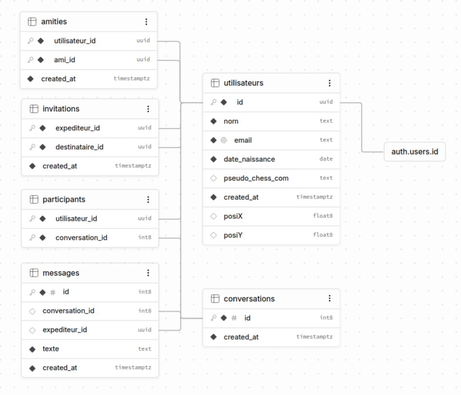

# Messagerie

## 1. Présentation du projet
Nous avons décidé de créer une messagerie pour un public cible. Un public qui correspond à des geeks/nerds. En effet, la messagerie aura un thème personnalisé à ce type d’utilisateurs. 
## 2. Fonctionnalités
### 2.1 Fonctionnalités principales
- [X] Inscription
- [X] Connexion
- [X] Gestion des contacts
- [X] Invitations
- [X] Conversations
- [X] Messages en temps réel
- [X] Horodatage

### 2.2 Fonctionnalités bonus
- [ ] Notifications visuel ou sonor
- [ ] Partage d'images
- [ ] Statut en ligne, hors ligne
- [ ] Indicateur « en train d'écrire »

### 2.3 Fonctionnalités supplémentaires
- [X] CHESS.COM -> Lors de l'inscription, un utilisateur peut renseigner son pseudo Chess.com. L'objectif est de pouvoir utiliser les données de Chess.com pour partager automatiquement des statistiques en appuyant sur le bouton spécial.

- [X] METEO -> Un compte utilisateur va contenir une position approximative. Cette position pourrait être utilisée pour récupérer les conditions météorologiques locales grâce à une API météo. L'objectif serait de personnaliser l'apparence des messages en fonction de la météo de chaque utilisateur : soleil, pluie ou autres effets visuels.

## 3. Technologies utilisées
| Technologie | Description |
|----|----|
| HTML, CSS, JavaScript | Interface et Fonctionnement interne du site web |
| Supabase | Service backend, gestion des identifiants de connexion et stockage |
| Google Fonts| Chargment de la police Cinzel |

## 4. Architecture du projet
### 4.1 Structure des fichiers
```
messagerie/
├── index.html                  Connexion et inscription
├── contacts.html               Page gestion des contacts    
├── conversations.html          Pages des conversations
└── CSS/
    ├── style.css               Personnalisation de l'apparence de toutes les pages
└── JS/
    ├── contacts.js             Backend page contact.html
    ├── index.js                Backend page index.html
└── images/                     Stockage d'images utilisé dans le projet
```

### 4.2 Architecture de la base de données


### Description des tables :


| Table | Rôle |
|----|----|
|utilisateurs|Stocke les informations des profils utilisateurs : nom, e-mail, date de naissance, pseudo Chess.com et position géographique.|
|amities|Stocke les relations entre utilisateurs et leurs contacts.|
|invitations|Stocke les invitations envoyées entre utilisateurs.|
|conversations|Prévue pour stocker les différentes conversations.|
|participants|Associe les utilisateurs aux conversations auxquelles ils participent.|
|messages|Prévue pour stocker les messages envoyés dans les conversations.|


## 5. API et services externes
### 4.1 Supabase
Le projet utilise Supabase pour l'authentification et le stockage des données.

Les fichiers JavaScript utilisent l'URL du projet Supabase ainsi que sa clé publique (publishable key) pour initialiser le client.


### 4.2 Chess.com
### 4.3 Meteo
## 6. Améliorations possibles
Plusieurs améliorations peuvent être apportées au projet :

- Configurer et vérifier les politiques RLS sur toutes les tables.
- Restreindre l'accès aux données selon l'utilisateur connecté.
- Améliorer la gestion des erreurs et des cas particuliers.
- Développer les notifications.
- Améliorer l'expérience utilisateur et les fonctionnalités sur mobile.

## 7. Auteurs
Anil RAMATOLA (RAMA01029900)

Octave ROUFFAUD (ROUO16090500)
